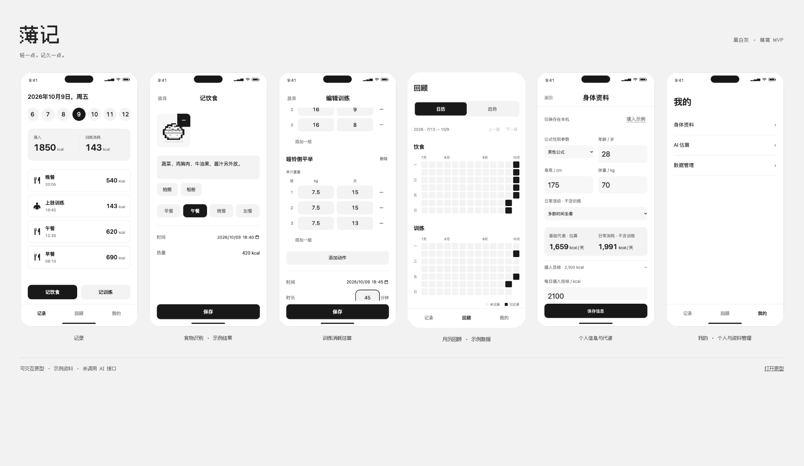

# 薄记 · Boji

轻一点，记久一点。

饮食与训练记录应用。根目录提供 **v0.6 网页交互原型**，原生 iPhone 工程位于 `ios/`。界面采用黑白灰、系统字体和少量圆角；餐食照片保留原色，像素字仅保留在网页品牌标识。



## 当前功能

- 饮食照片、文字、餐次与时间记录，以及编辑、删除和撤销。
- 训练一次录入并保存，支持修改、常用／自定义动作与添加组，无进行中状态。
- 个人信息录入、静息代谢与日常消耗估算。
- 基于体重、时长和训练类型估算运动净消耗。
- 食物 AI 识别的交互演示、逐项份量与热量修正。
- 回顾显示饮食／训练两张 13 周记录日历，以及 7／30 天摄入／训练净消耗平滑曲线；不重复当天明细。
- 「我的」仅保留身体资料、AI 估算、数据管理。
- 本地记录与图片 JSON 导出。

## 运行

这是静态网页原型，无需构建。进入仓库目录启动服务：

```sh
python3 -m http.server 8765 --bind 127.0.0.1
```

打开 <http://127.0.0.1:8765/>。请通过本地 HTTP 服务访问，以保证图片导出等功能正常工作。

## 文件入口

- `index.html`：可交互原型。
- `gallery.html`：主要界面总览。
- `energy-spec.html`：热量功能、计算口径、AI 接口约定、v0.6 视觉与产品边界。
- `design-spec.html`：早期记录功能设计。
- `app.js` / `redesign.js` / `energy.js`：基础交互、简化视觉层和热量功能层。
- `home.js` / `home.css`：首页专属的 31 天日期横条、热量总览与单列记录。
- `review.js` / `review.css` / `review-data.js`：双记录日历、双热量曲线及纯展示计算。
- `style.css` / `mono.css` / `typography.css` / `energy.css`：样式与字体。
- `pixel-font.css` / `pixel.css` / `pixel.js`：v0.6 像素字体、视觉层、原创像素图标与示例插画的展示替换。
- `assets/`：字体、许可证、示例照片和 SVG 插画。

## 浏览器验证

需要 Node.js 和本机安装的 Google Chrome。启动上述预览服务后：

```sh
npm install
npm test
```

`npm run capture` 重新生成最新热量功能截图。测试使用独立浏览器上下文，不读取用户日常浏览器的数据。截图中的个人信息、照片和记录均为示例。

## 产品边界与隐私

- 本说明的浏览器版本是设计原型；原生 iPhone 工程的构建和运行见 `ios/README.md`。
- **食物 AI 识别是明确标注的模拟演示，未调用真实模型接口。** 真实上传照片不会获得伪造的识别结果。
- 未连接 iCloud 或其他同步服务。记录存储在当前浏览器的 `localStorage` 中，不适合作为正式健康资料存储方案。
- 仓库不包含用户浏览器中的记录、个人资料、导出数据或 API 密钥。导出文件可能包含身体信息与照片，分享前请自行检查。
- 热量与代谢数值仅为估算，非医学测量或医疗建议。公式来源和限制见 `energy-spec.html`。

## 素材许可

- 当前字体 Fusion Pixel：来自作者官方站点，采用 SIL Open Font License 1.1。许可见 `assets/OFL-Fusion-Pixel.txt`；来源 <https://github.com/TakWolf/fusion-pixel-font>。
- ZCOOL KuaiLe / 站酷快乐体：`assets/OFL-ZCOOL-KuaiLe.txt`。
- Patrick Hand：`assets/OFL-Patrick-Hand.txt`。
- 上述两种早期字体文件来自 Google Fonts 官方仓库，以 SIL Open Font License 1.1 分发。
- 两张早期 Unsplash 照片保留作为示例／上传测试素材，来源见 `design-spec.html`。当前演示餐食使用下列照片；早期手绘字体与像素 SVG 插画保留作历史设计资源。
- 未为项目代码另行授予开源许可证；第三方素材仍遵循各自许可。

## 真实状态样例来源

- 餐食照片来自 Unsplash：[Olya P](https://unsplash.com/photos/fried-egg-with-avocado-toast-breakfast-orMrxgkA4EA)、[joe boshra](https://unsplash.com/photos/healthy-chicken-and-rice-bowl-with-fresh-vegetables-tB2MPTiSrsg)、[sunorwind](https://unsplash.com/photos/salmon-sashimi-bowl-with-rice-and-garnishes-cwqI5PcUsqQ)、[Matilda Jarl](https://unsplash.com/photos/a-bowl-of-granola-with-yogurt-and-blueberries-9Uphjae3YnU)、[Mantra Media](https://unsplash.com/photos/steak-with-vegetables-on-plate-XPvhzVIeETM)、[You Le](https://unsplash.com/photos/a-bowl-of-delicious-laksa-soup-with-noodles-and-shrimp-2h-BQpdUmYo) 与 [Thanti Riess](https://unsplash.com/photos/meat-and-vegetables-YPMdhn9gEp0)。
- 默认状态包含 2026-10-03 至 2026-10-09 的 21 条饮食、3 次训练和一份个人资料，用于观察完整一周的首页、回顾与热量趋势。
- 餐食文字、份量、热量、训练组数与个人资料均为虚构样例，不代表照片作者或当前用户；照片无法证明实际份量，热量仍是原型中的演示估算。

## UI 简化原则

参考 HabitKit 的留白、清晰字号和方格历史，将界面收敛为只服务记录、估算与回顾的单色手账。

1. **先确定当前任务。** 记录页用于识别和打开记录，表单用于完成录入，回顾页用于理解变化，设置页用于找到选项。同一屏不让次要说明与主任务竞争。
2. **用布局处理留白。** 内容少时调整尺寸、比例和排列；首页使用单列横条，只显示分类图标、餐次／训练部位、时间与热量；照片和详细内容在详情中查看，不补装饰性文案。
3. **按需展开细节。** 时间、分类、标签、公式、估算明细、历史版本和技术说明进入详情或折叠区。输入标签、单位、错误、关键状态和执行前必要提示仍然可见。
4. **让相同内容落在相同位置。** 热量数字与单位统一层级；同类记录、控件和设置行使用相同间距、圆角和对齐。信息密度来自结构，不依赖多层框体。
5. **用克制的视觉层级。** 白色画布、灰色表面、黑色主操作；去掉硬阴影和重复粗描边。列表与表单优先轻分隔，避免卡片套卡片。
6. **简化呈现，保留事实和能力。** 不把未知热量显示成零，不把未保存输入计入训练，不把示例当真实识别。保存、编辑、导入导出、授权与恢复等能力继续可用，并保留键盘、屏幕阅读器及系统字号支持。

### 视觉约定

- 色彩：网页浅色画布 `#fff`、正文 `#191919`、次要文字 `#666`、灰色表面 `#f3f3f3`；深色使用对应的语义颜色。原生遵循系统明暗模式。
- 间距：以 4px / 4pt 为基准；页面通常 16–24，控件间距 8–16，分区间距 20–24。
- 容器：记录卡圆角 16，按钮和表面圆角 12；图片圆角 10–12。依靠背景区分层级，少用边框和阴影。
- 字体：网页正文与控件使用系统字体 14–16px，核心数字 30px；原生使用可缩放的系统语义字号。Fusion Pixel 仅用于网页品牌。
- 操作：训练卡片直接进入编辑，详情与历史按需打开。每个任务保留一个明确的主动作，主要操作的点击区域至少 44px / 44pt；紧凑选择控件保留清晰间距。折叠内容仍可通过键盘与辅助功能访问。
- 我的：身体资料、AI 估算、数据管理三条文字入口。数据管理保留导出、导入恢复与回收站；网页原型只提供已实现的 JSON 导出。
- 图像：首页不显示照片；用户照片保持原图，训练名称和动作在训练编辑器中查看。示例素材不进入真实记录的推断。
- 验证：饮食/训练录入和编辑、个人资料、7/30 天回顾、未知/空白/失败状态、浅色/深色、320/393px 网页，以及原生小屏与大字号。

### 当前 MVP 的删减边界（2026-10-24）

阶段目标与阶段历史、独立 Agent 复盘、自动目录备份、正式界面的演示入口退出当前产品导航。原生不再启动目录备份轮询；已有目录文件、历史数据和资料包字段保留，旧资料仍可导入与导出。演示切换只在 Debug 构建显式传入 `--ui-test-demo-controls` 时供测试使用。

回顾已移除「已记全」确认及盈亏统计，旧完整度字段保留兼容。记录日历深色方格只表示有记录；未知热量在趋势中留空断线，不按零计入。

### 首页日期与记录（2026-10-24）

首页日期固定为今天前后各 15 天，首次居中；网页的示例时钟为 2026-10-09，iPhone 使用设备当地日期。点击日期保持横向滚动位置，可通过触摸、触控板或网页鼠标拖动浏览。首页遇到范围外的日期会回到今天；更早记录从回顾页查看。

摄入与训练净消耗合并为一张总览卡，首页数字不使用千位分隔符。点击进入现有趋势；缺少估算显示未知，草稿不进入统计。记录按时间倒序，饮食按餐次，训练优先根据名称、再根据动作展示上肢／下肢／核心／全身；无法判定保留通用分类。分类不写回数据，照片与原名称继续保留。


首页本轮细化：顶部直接显示所选完整日期（如 `2026年10月9日，周五`），删除 App 标题。日期使用仅含数字的圆形按钮，保留完整日期的无障碍标签；日期区留白、热量区灰底、记录区白底细描边，深色模式对应反转。首页不再提供「这天基本记全」或重复的当天汇总，既有历史完整度数据与回顾统计保留。


### 训练录入（2026-10-24）

训练与饮食一样，直接填写、保存，再按需修改。首页只展示正式保存的记录，不显示进行中／编辑中，也不展示未保存输入。表单只保留「放弃」与「保存」：关闭即放弃，未保存输入不落盘，重新进入或重启均不恢复，不弹暂存／冲突选择；保存时校验全部组，一次写入，修改沿用原记录身份。移除逐组确认、训练进度与结束训练操作，原历史数据和热量快照保留。

### 四个录入表单精简（2026-10-24）

「记饮食／编辑饮食」保留照片、文字、四个餐次、时间与热量；去掉标签输入、照片排序、折叠信息和重复估算说明。「记训练／编辑训练」保留名称、动作、组／重量／次数、时间、时长与强度；去掉批量录入、排序和多余操作菜单。添加一组直接沿用上一组，历史照片、标签、名称及估算记录保留。

点击已有饮食记录直接进入预填的编辑表单，不再经过只读详情页。底部固定并排「保存／删除／返回」，返回放弃未保存修改；删除针对已保存的原记录，不先提交当前输入。新建仍保留保存／放弃。网页可撤销删除，iPhone 确认后移到回收站；已有元数据与估算历史保留。

四个页面采用白色画布、浅灰输入框和底部固定保存按钮，内容与时间／热量之间只留一条细分隔线。顶部统一「放弃」，不展示暂存或恢复流程。网页验收包含 320/393px、浅深色和保存／放弃行为，截图位于 `editor-screenshots/`。

### 双记录日历与双趋势曲线（2026-10-25）

回顾日历分别显示饮食与训练是否记录，每页 13 周，可按段翻页。趋势分别显示每日摄入与训练净消耗，7／30 天可切换和翻页；平滑曲线经过实际数据，缺失日期断线，真实零值保留。两张图使用独立纵轴，全部热量不加千位逗号。页面不再包含当天汇总、记录列表和详情入口。原始数据不改变；截图位于 `review-screenshots/`，原生规则见 `ios/docs/review.md`。
